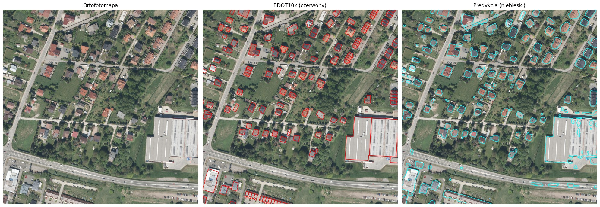

# Segmentacja semantyczna dachów budynków na ortofotomapie RGB z wykorzystaniem obrysów BDOT10k jako etykiet uczących (powiat wielicki)

## Streszczenie

Celem pracy była ocena przydatności obrysów budynków z Bazy Danych Obiektów Topograficznych (BDOT10k) jako etykiet uczących dla konwolucyjnej sieci neuronowej segmentującej dachy na ortofotomapie RGB o rozdzielczości 5 cm. Wykorzystano architekturę U-Net z enkoderem ResNet-34 wstępnie wytrenowanym na zbiorze ImageNet. Model trenowano na kaflach 512 × 512 px z jednego arkusza ortofotomapy (Wieliczka) przy przestrzennym podziale danych na zbiory uczący, walidacyjny i testowy. Na kaflach testowych uzyskano pikselowe IoU równe 0,54–0,64 w dwóch niezależnych przebiegach treningu. W ocenie obiektowej na całym arkuszu wykryto 95% budynków BDOT10k (precision 0,66). Analiza tolerancji przesunięcia obrysu wskazuje, że znaczna część błędów pikselowych wynika z niezgodności geometrycznej etykiet z obrazem: okapów, przesunięć radialnych i nieaktualności bazy. Nie są to więc wyłącznie błędy klasyfikacji.



*Rys. 1. Fragment arkusza: ortofotomapa, obrysy budynków BDOT10k (czerwone) i wynik segmentacji (niebieskie).*

Szczegółowe wyniki zawiera [prezentacja (PDF)](prezentacja/Segmentacja_dachow_z_ortofotomapy.pdf).

## 1. Cel i zakres

1. Wytrenowanie modelu segmentacji semantycznej dachów na ortofotomapie RGB przy użyciu masek wygenerowanych z BDOT10k, bez ręcznego oznaczania danych.
2. Ocena wyników na dwóch poziomach: pikselowym i obiektowym (pojedynczych budynków).
3. Ilościowe oszacowanie wpływu niezgodności geometrycznej etykiet BDOT10k z ortofotomapą na metryki jakości.

## 2. Obszar badań i dane

**Obszar badań.** Powiat wielicki (TERYT 1219, woj. małopolskie) obejmuje 5 gmin: Wieliczkę, Niepołomice, Gdów, Kłaj i Biskupice. Według BDOT10k na jego terenie znajduje się 70 435 budynków o łącznej powierzchni zabudowy 945 ha. Dominują budynki jednorodzinne (64%) oraz gospodarcze i garaże (29%). Budynki wielorodzinne, przemysłowe, magazynowe i handlowe stanowią ok. 3% obiektów. Do trenowania i oceny wykorzystano arkusz ortofotomapy obejmujący część Wieliczki, z 3 334 budynkami BDOT10k.

**Tabela 1.** Dane wejściowe

| Zbiór | Charakterystyka |
|---|---|
| Ortofotomapa (GUGiK) | arkusz M-34-77-A-a-2-1; RGB, 3 kanały; terenowy rozmiar piksela 0,05 m; 45 455 × 46 959 px (ok. 2,27 × 2,35 km); układ PL-1992 (EPSG:2180) |
| BDOT10k (GUGiK) | klasa OT_BUBD_A (budynki), powiat wielicki; 70 435 poligonów, w tym 3 334 w zasięgu arkusza |

Dane nie są częścią repozytorium. Plik ortofotomapy (1,2 GB) przekracza limit rozmiaru pliku w serwisie GitHub. Oba zbiory są udostępniane przez GUGiK (geoportal.gov.pl).

## 3. Metodyka

### 3.1. Przygotowanie danych

- **Etykiety:** poligony budynków BDOT10k zrasteryzowano w siatce ortofotomapy (piksel należy do budynku, gdy jego środek leży wewnątrz poligonu). Nie stosowano erozji ani buforowania obrysów.
- **Kafle:** obraz podzielono na kafle 512 × 512 px (25,6 × 25,6 m) bez nakładania, co dało 8 008 kafli. Każdy kanał znormalizowano w obrębie kafla do zakresu [0, 1] według 2. i 98. percentyla.
- **Podział danych:** w celu ograniczenia autokorelacji przestrzennej kafle pogrupowano w bloki 4 × 4 kafle (102,4 × 102,4 m). Bloki losowo (ziarno 42) przypisano do zbiorów w proporcji 70/15/15%. Zbiór uczący liczy 5 596 kafli, walidacyjny 1 200, a testowy 1 212.

### 3.2. Model i trening

- **Architektura:** U-Net [1] z enkoderem ResNet-34 [2] (wagi ImageNet), implementacja `segmentation_models_pytorch` [3]. Model ma jedno wyjście, z którego funkcja sigmoidalna daje prawdopodobieństwo przynależności piksela do budynku.
- **Funkcja straty:** 0,5 · BCE + 0,5 · Dice, co kompensuje niezrównoważenie klas.
- **Optymalizacja:** AdamW [4], współczynnik uczenia 3·10⁻⁴, *weight decay* 10⁻⁴, rozmiar paczki 8, obliczenia w mieszanej precyzji (AMP), maks. 15 epok.
- **Wczesne zatrzymanie:** cierpliwość 8 epok. Do dalszej oceny wybierano model z najwyższym IoU na zbiorze walidacyjnym.
- **Augmentacja:** losowe odbicia poziome i pionowe (p = 0,5), obroty o wielokrotność 90°, losowa zmiana jasności (p = 0,3; wzmocnienie 0,9–1,1, przesunięcie ±0,03).
- **Sprzęt:** GPU NVIDIA Tesla T4 (Google Colab).

### 3.3. Predykcja i wektoryzacja

Arkusz przetworzono oknami 512 × 512 px bez nakładania. Mapę prawdopodobieństwa progowano wartością 0,5 i zwektoryzowano. Poligony uproszczono algorytmem Douglasa–Peuckera (tolerancja 0,1 m) i odrzucono te o powierzchni poniżej 4 m². Wynik zapisano w formacie GeoPackage.

### 3.4. Ocena

- **Poziom pikselowy:** precision, recall, F1 i IoU = TP / (TP + FP + FN), liczone łącznie dla wszystkich kafli zbioru testowego względem masek BDOT10k (próg 0,5).
- **Poziom obiektowy:** budynek BDOT10k uznano za wykryty, gdy co najmniej 50% jego powierzchni pokrywa predykcja (recall). Poligon predykcji uznano za trafny, gdy co najmniej 50% jego powierzchni leży na budynku BDOT10k (precision). Kryterium nie wymaga przyporządkowania jeden do jednego. Analizę wykonano na rastrze 0,5 m dla całego arkusza.
- **Tolerancja przesunięcia:** metryki pikselowe przeliczono przy buforze o szerokości 0–3 m. Bufor nakładano na maskę BDOT10k przy liczeniu precision i na predykcję przy liczeniu recall.

## 4. Wyniki

### 4.1. Ocena pikselowa na zbiorze testowym

**Tabela 2.** Metryki pikselowe na kaflach testowych (n = 1 212) dla dwóch niezależnych przebiegów treningu

| Przebieg | Epoki | Precision | Recall | F1 | IoU |
|---|---|---|---|---|---|
| A | 9 | 0,59 | 0,87 | 0,70 | 0,54 |
| B | 10 (najlepsza: 2.) | 0,71 | 0,86 | 0,78 | 0,64 |

Przebieg B odpowiada wynikom zapisanym w notebooku. Różnica IoU o 0,10 między przebiegami przy identycznej konfiguracji wskazuje na dużą wrażliwość wyniku na losowość treningu. W obu przebiegach krzywe straty walidacyjnej są niestabilne.

### 4.2. Ocena obiektowa (przebieg A, cały arkusz)

Na całym arkuszu (3 334 budynki BDOT10k, 3 368 poligonów predykcji) recall obiektowy wyniósł 0,95, a precision 0,66. Metryki pikselowe dla tego samego obszaru wyniosły: precision 0,69, recall 0,88, F1 0,77, IoU 0,63.

**Tabela 3.** Recall obiektowy według funkcji budynku

| Funkcja budynku | n | Recall |
|---|---|---|
| Jednorodzinne | 2 583 | 0,98 |
| Wielorodzinne | 76 | 0,97 |
| Inne (oświata, usługi i in.) | 68 | 0,97 |
| Przemysłowe, magazynowe, handlowe | 169 | 0,89 |
| Gospodarcze i garaże | 438 | 0,75 |

**Tabela 4.** Recall obiektowy według powierzchni budynku w BDOT10k

| Powierzchnia [m²] | < 20 | 20–50 | 50–100 | 100–200 | 200–500 | > 500 |
|---|---|---|---|---|---|---|
| Recall | 0,76 | 0,75 | 0,94 | 0,98 | 0,98 | 1,00 |

**Fałszywe pozytywy.** 1 157 z 3 368 poligonów (34%) nie spełniło kryterium trafności. Według powierzchni rozkładają się następująco:
- 520 poligonów ma powierzchnię poniżej 20 m²,
- 475 ma 20–100 m², a część z nich to wiaty i szopy nieujęte w BDOT10k,
- 162 mają co najmniej 100 m²: są to głównie zaorane pola, boiska o czerwonej nawierzchni i place.

Ponadto 501 poligonów obejmuje dwa lub więcej budynków BDOT10k. Dotyczy to głównie bliźniaków, szeregowców i domów z przyległym garażem.

### 4.3. Wpływ tolerancji przesunięcia obrysu

Dopuszczenie przesunięcia obrysu o 1,5 m zwiększa pikselowe precision z 0,69 do 0,81, a przy 3 m do 0,86. Recall rośnie w tym samym zakresie z 0,88 do 0,98.

## 5. Dyskusja

Maski BDOT10k są etykietami obarczonymi systematycznym szumem geometrycznym z trzech powodów:
- **Obrys przyziemia.** Geometria budynków (w dużej mierze przejęta z EGiB) odwzorowuje obrys ścian zewnętrznych przy gruncie, podczas gdy na ortofotomapie widoczna jest cała połać dachu wraz z okapem.
- **Przesunięcie radialne.** Ortofotomapa nie jest ortofotomapą prawdziwą (*true ortho*), więc dachy wyższych budynków są przesunięte względem ich podstawy.
- **Niezgodność czasowa.** W bazie brakuje nowych obiektów, a obiekty rozebrane nadal w niej figurują.

Wzrost precision o 0,12 przy tolerancji 1,5 m potwierdza, że metryki pikselowe względem BDOT10k zaniżają rzeczywistą jakość segmentacji. Ocena obiektowa jest na te efekty mniej wrażliwa.

Błędy modelu mają charakter systematyczny. Fałszywe pozytywy dotyczą powierzchni o barwie i teksturze zbliżonej do dachówki ceramicznej, czyli zaoranych pól i nawierzchni boisk, słabo reprezentowanych w danych uczących jako przykłady negatywne. Najniższy recall dotyczy małych budynków gospodarczych (< 50 m²), często częściowo przesłoniętych koronami drzew. W dachach hal przemysłowych występują nieciągłości w miejscach świetlików i instalacji fotowoltaicznych.

### Ograniczenia

1. Dane pochodzą z jednego arkusza ortofotomapy, więc nie oceniono zdolności uogólniania na inne obszary, daty nalotu ani warunki oświetleniowe.
2. Ocena obiektowa (rozdz. 4.2–4.3) obejmuje cały arkusz, w tym kafle uczące i walidacyjne (ok. 85% powierzchni). Jej wyniki nie stanowią niezależnej oceny na danych testowych i należy je traktować jako optymistyczne.
3. Podział na bloki 102,4 m ogranicza, lecz nie eliminuje autokorelacji przestrzennej między zbiorami.
4. Brak niezależnych danych referencyjnych o rzeczywistych obrysach dachów. Wszystkie metryki mierzą zgodność z BDOT10k.
5. Wektoryzacja odbywa się niezależnie w każdym oknie 512 px, więc budynki przecięte granicą okna mogą zostać podzielone na kilka poligonów.

## 6. Wnioski

1. Obrysy BDOT10k mogą służyć jako etykiety uczące do segmentacji dachów na ortofotomapie bez ręcznego oznaczania danych. Na badanym arkuszu model wykrył co najmniej 97% budynków mieszkalnych (z zastrzeżeniem ograniczenia 2).
2. Metryki pikselowe liczone względem BDOT10k zaniżają jakość segmentacji z powodu niezgodności geometrycznej etykiet. Bardziej adekwatna jest ocena obiektowa lub ocena z tolerancją przesunięcia.
3. Dalsze prace powinny objąć:
   - uzupełnienie danych uczących o przykłady negatywne (pola, boiska, place),
   - postprocessing (filtr minimalnej powierzchni, operacje morfologiczne),
   - korektę dopasowania masek do obrazu,
   - ocenę na niezależnych arkuszach z pozostałych gmin powiatu.

## 7. Reprodukowalność

Pełny przebieg obliczeń zawiera notebook [`segmentacja_dachow_colab.ipynb`](segmentacja_dachow_colab.ipynb), który można uruchomić w [Google Colab](https://colab.research.google.com/github/mwiktorowicz/Segmentacja_semantyczna/blob/main/BDOT10k/segmentacja_dachow_colab.ipynb). Notebook pobiera kod pipeline'u z repozytorium [przemek-kuras/bdot10k_bldg_segment](https://github.com/przemek-kuras/bdot10k_bldg_segment), ustawia konfigurację opisaną w rozdz. 3 i uruchamia kolejne etapy.

Aby uruchomić obliczenia:
1. Wybierz środowisko z GPU (T4).
2. Umieść oba zbiory danych w Google Drive i ustaw ścieżkę `DRIVE_DIR`.
3. Uruchom najpierw komórkę montującą Google Drive, a następnie kolejne komórki.

Projekt zrealizowano zespołowo w ramach zajęć (listopad 2026).

## Literatura i źródła danych

1. Ronneberger O., Fischer P., Brox T. (2015). U-Net: Convolutional Networks for Biomedical Image Segmentation. *MICCAI 2015*, LNCS 9351, 234–241.
2. He K., Zhang X., Ren S., Sun J. (2016). Deep Residual Learning for Image Recognition. *CVPR 2016*, 770–778.
3. Iakubovskii P. (2019). Segmentation Models Pytorch. https://github.com/qubvel-org/segmentation_models.pytorch
4. Loshchilov I., Hutter F. (2019). Decoupled Weight Decay Regularization. *ICLR 2019*.
5. Główny Urząd Geodezji i Kartografii: ortofotomapa, Baza Danych Obiektów Topograficznych BDOT10k. https://www.geoportal.gov.pl

## Zawartość repozytorium

```
BDOT10k/
├── segmentacja_dachow_colab.ipynb   notebook: pipeline, wyniki przebiegu B, szkielet eksperymentów
├── prezentacja/
│   ├── Segmentacja_dachow_z_ortofotomapy.pdf
│   └── Segmentacja_dachow_z_ortofotomapy.pptx
├── img/
│   └── porownanie_bdot_predykcja.jpg
└── README.md
```

Plik `.gitignore` w katalogu głównym repozytorium wyklucza dane wejściowe, kafle i wagi modelu.
